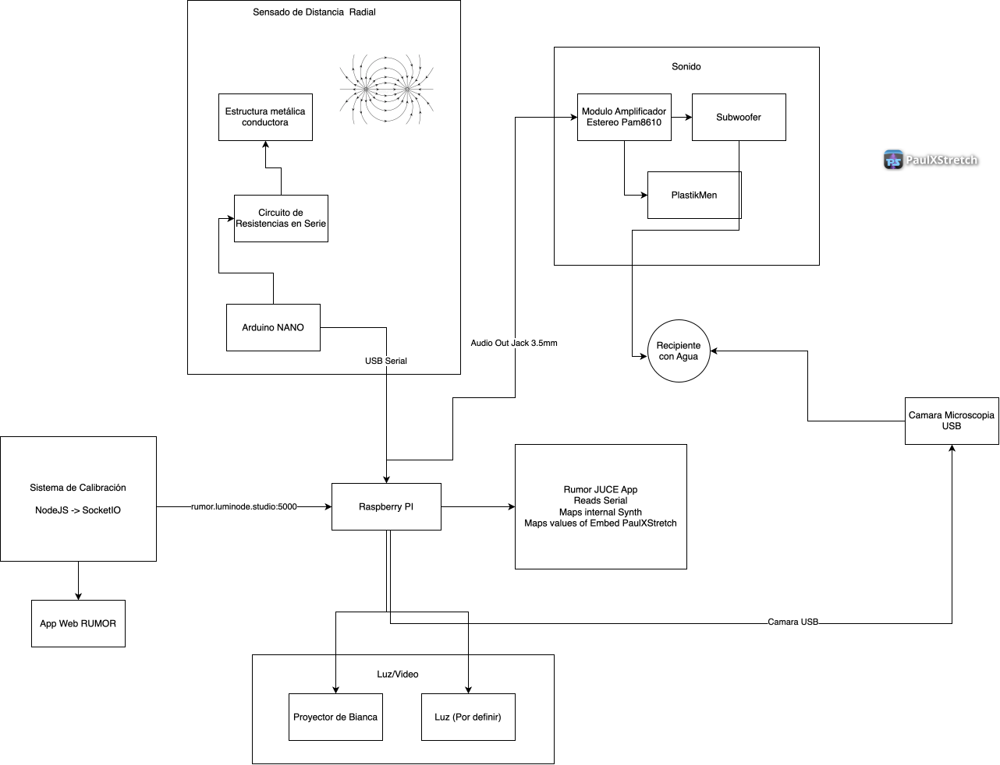

# RUMOR

Software para una **instalación interactiva** de sonido, agua, vibración y luz. Corre en una Raspberry Pi: lee un sensor serial (estructura conductora vía Arduino NANO), genera audio con dos motores: **un sintetizador harmónico** (para controlar la vibración de resonadores y movimiento de agua) y **[PaulXStretch](https://github.com/essej/paulxstretch)** (estiramiento espectral) y envía la señal a excitadores y sonido de la sala. La **calibración remota** está en desarrollo.

---

## Documentación


| Documento                                                           | Contenido                                                  |
| ------------------------------------------------------------------- | ---------------------------------------------------------- |
| [firmware/capacitive-sensor/](firmware/capacitive-sensor/README.md) | Sketch Arduino del sensor capacitivo, cableado y Serial    |
| [hardware/alcantarilla/](hardware/alcantarilla/README.md)           | Modelo de la placa (SVG / DXF / GLB) para fabricación      |
| [docs/TODO.md](docs/TODO.md)                                        | Pendientes (calibración remota, presencia, Pi headless, …) |


Upstream de PaulXStretch: [essej/paulxstretch](https://github.com/essej/paulxstretch) (GPL-3).

---


## Visión general del sistema




| Bloque          | Rol                                                            |
| --------------- | -------------------------------------------------------------- |
| **Sensado**     | Estructura metálica → Arduino NANO → USB Serial → Raspberry Pi |
| **Calibración** | App web remota — *en desarrollo*                               |
| **Rumor app**   | Lee serial, mapea parámetros a los motores de audio            |
| **Sonido**      | Jack → amp → subwoofer + excitadores → recipiente con agua     |


---


## Arquitectura de software

```text
RUMOR (plugin / standalone / headless)
│
├── Motores de audio
│   ├── Sinte (síntesis + granular)
│   └── PaulXStretch — texturas estiradas / espectrales
│
├── Control
│   ├── Serial (Arduino), destinos (≤16)
│   ├── Presets / parámetros
│   └── MIDI CC out
│
└── Host
    ├── JUCE (VST3 / AU)
    ├── Standalone
    └── Headless Linux (Pi) — pendiente
```

Probar primero el Standalone en Mac/Windows; despliegue headless en Pi pendiente. Detalle en [docs/TODO.md](docs/TODO.md).

---


## Clonar y sincronizar


### Opción A — [GitDesktop](https://gitdesktop.app/) (recomendada)

1. Instalá desde [gitdesktop.app](https://gitdesktop.app/) e iniciá sesión en tu forge.
2. **Clonar:** *Explore / Clone* → URL del remoto → carpeta destino (p. ej. `~/Projects/RUMOR`).
3. **Abrir un clone existente:** *Add* / *Open*.
4. **Sincronizar:** *Fetch* + *Pull* / *Push*.


### Opción B — Línea de comandos

```bash
git clone <URL-DEL-REMOTO-RUMOR>.git ~/Projects/RUMOR
cd ~/Projects/RUMOR

git fetch origin
git pull --ff-only
git push
```

Si el árbol local aún no tiene remoto:

```bash
cd ~/Projects/RUMOR
git init
git remote add origin <URL-DEL-REMOTO-RUMOR>.git
git add .
git commit -m "Initial RUMOR scaffold"
git branch -M main
git push -u origin main
```


### Dependencias en `deps/`


| Symlink             | Destino típico                                                       |
| ------------------- | -------------------------------------------------------------------- |
| `deps/JUCE`         | JUCE 8                                                               |
| `deps/PaulXStretch` | clone de [essej/paulxstretch](https://github.com/essej/paulxstretch) |


---


## Estructura del repo

```text
RUMOR/
  app/                 # UI / processor JUCE
  src/                 # DSP, serial, parámetros, config
  engines/             # IAudioEngine + sinte + paulxstretch
  firmware/            # Arduino (sensor → USB Serial)
  hardware/            # Fabricación (alcantarilla SVG/DXF/GLB)
  config/              # serial.json y mapping de ejemplo
  docs/                # diagramas + TODO
  tests/
  third_party/         # subset PaulXStretch, json, …
```

---


## Build

Requisitos: CMake ≥ 3.22, C++17. JUCE 8 en `deps/JUCE` (o FetchContent).


| Plataforma  | Script                                                   | Salida típica                                        |
| ----------- | -------------------------------------------------------- | ---------------------------------------------------- |
| **macOS**   | `[scripts/build-mac.sh](scripts/build-mac.sh)`           | `build/Rumor_artefacts/Release/Standalone/RUMOR.app` |
| **Windows** | `[scripts/build-windows.ps1](scripts/build-windows.ps1)` | `build\Rumor_artefacts\Release\Standalone\RUMOR.exe` |


CI: `[.github/workflows/build.yml](.github/workflows/build.yml)` (macOS + Windows).

### macOS

```bash
./scripts/build-mac.sh
# o a mano:
cmake -B build -DCMAKE_BUILD_TYPE=Release \
  -DRUMOR_WITH_PAULXSTRETCH=ON \
  -DRUMOR_BUILD_PLUGIN=ON
cmake --build build --target Rumor_Standalone -j
open build/Rumor_artefacts/Release/Standalone/RUMOR.app
```


| Target     | Salida                                               |
| ---------- | ---------------------------------------------------- |
| Standalone | `build/Rumor_artefacts/Release/Standalone/RUMOR.app` |
| VST3       | `…/VST3/RUMOR.vst3`                                  |
| AU         | `…/AU/RUMOR.component`                               |


### Windows

Requisitos: Visual Studio 2022 (MSVC), CMake, Git.

```powershell
.\scripts\build-windows.ps1
```


| Target     | Salida                                               |
| ---------- | ---------------------------------------------------- |
| Standalone | `build\Rumor_artefacts\Release\Standalone\RUMOR.exe` |
| VST3       | `build\Rumor_artefacts\Release\VST3\RUMOR.vst3`      |


Opciones CMake:

- `-DRUMOR_WITH_PAULXSTRETCH=OFF` — solo sinte (sin GPL de PX en el link)
- `-DRUMOR_BUILD_PLUGIN=OFF` — libs + tests
- `-DRUMOR_BUILD_TESTS=OFF`

---


## Flujo de la instalación

1. Alguien toca o se acerca a la estructura conductora.
2. El Arduino envía lecturas por USB Serial a la Pi.
3. La app mapea el valor a los motores de audio (sinte y/o PaulXStretch).
4. El audio amplificado vibra el recipiente de agua; la sala también responde a la proximidad.
5. Microscopía + proyector muestran el agua; la calibración remota (en desarrollo) ajustará umbrales desde la web.

