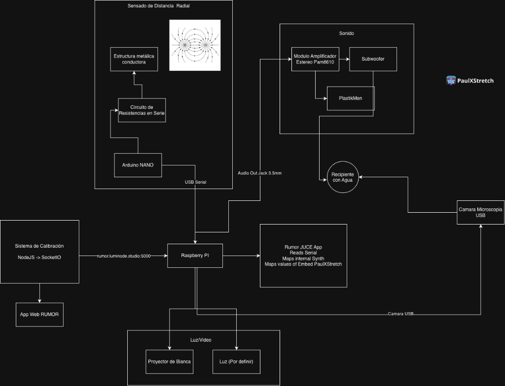

# RUMOR

**RUMOR** es una instalación interactiva de sonido, agua, vibración y luz. El software corre en una Raspberry Pi: lee un sensor serial (umbral conductor vía Arduino NANO), genera audio con el motor **UMBRAL** (síntesis granular) y/o **PaulXStretch** (estiramiento espectral extremo), y se calibra de forma remota.

---

## Visión general del sistema




| Bloque             | Rol                                                                                                      |
| ------------------ | -------------------------------------------------------------------------------------------------------- |
| **Sensado**        | Estructura metálica conductora → circuito de resistencias → Arduino NANO → **USB Serial** → Raspberry Pi |
| **Calibración**    | App web (Node.js / Socket.IO) en `rumor.luminode.studio:5000`                                            |
| **Rumor JUCE App** | Lee serial, mapea synth interno y parámetros de PaulXStretch embebido                                    |
| **Sonido**         | Jack 3.5 mm → PAM8610 → subwoofer + excitadores (Dayton Audio 4 Ω / “PlastikMen”) → recipiente con agua  |


---


## Arquitectura de software (en construcción)

```text
RUMOR (plugin / standalone / headless)
│
├── Selección de motor
│   ├── Granular Synth (UMBRAL) — por defecto
│   └── PaulXStretch — texturas estiradas / espectrales
│
├── Control compartido
│   ├── Serial (Arduino), calibración, destinos (≤16)
│   ├── Parameter registry / presets (sin guardar el puerto serial)
│   └── MIDI CC out (host + dispositivo de sistema, p. ej. IAC)
│
└── Audio
    ├── Host JUCE (VST3 / AU)
    ├── Standalone de escritorio
    └── Headless Linux (Raspberry Pi)
```

Estado (macOS): CMake unificado, **selector Granular / PaulXStretch**, carga de audio PX, destinos serial `px.`*, y **salida L/R mono** (balance Sub←→Dayton + gains + swap). Probar en Mac con el Standalone antes de la Pi. Headless Pi pendiente.

---


## Clonar y sincronizar el repositorio


### Opción A — [GitDesktop](https://gitdesktop.app/) (recomendada para UI)

[GitDesktop](https://gitdesktop.app/) es un cliente Git multiplataforma (Windows, macOS, Linux) para GitHub, GitLab y Bitbucket: staging, ramas, diffs, historial, PRs/CI y sync en una sola ventana. Es software libre ([Apache-2.0](https://gitdesktop.app/)).

1. Descarga e instala desde [gitdesktop.app](https://gitdesktop.app/).
2. Inicia sesión en tu forge (GitHub / GitLab / Bitbucket).
3. **Clonar:** *Explore / Clone* → pega la URL del remoto de RUMOR → elige carpeta destino (p. ej. `~/Projects/RUMOR`).
4. **Abrir un clone ya existente:** *Add* / *Open* → selecciona esta carpeta si ya la tenés en disco.
5. **Sincronizar:** *Fetch* periódico + *Pull* (`--ff-only` por defecto) / *Push*. Ante divergencia, GitDesktop usa `--force-with-lease` (no un `--force` a ciegas).
6. Commits: podés redactar el mensaje a mano o usar la generación opcional de mensajes desde el diff (desactivable).

> Tip: si trabajás en un fork, usá el conmutador Fork | Upstream en PRs/issues sin reclonar.


### Opción B — Línea de comandos (`git`)

```bash
# Clonar (reemplazá la URL por el remoto real cuando exista)
git clone <URL-DEL-REMOTO-RUMOR>.git ~/Projects/RUMOR
cd ~/Projects/RUMOR

# Sincronizar después
git fetch origin
git pull --ff-only
git push
```

Si ya tenés el árbol de trabajo sin `.git` (scaffold local), inicializá y conectá el remoto:

```bash
cd ~/Projects/RUMOR
git init
git remote add origin <URL-DEL-REMOTO-RUMOR>.git
git add .
git commit -m "Initial RUMOR scaffold"
git branch -M main
git push -u origin main
```


### Opción C — GitHub CLI / GitLab CLI

```bash
# GitHub
gh repo clone <owner>/RUMOR ~/Projects/RUMOR

# GitLab
glab repo clone <owner>/RUMOR ~/Projects/RUMOR
```

GitDesktop también puede orquestar estas CLIs por debajo en GitHub/GitLab.

### Dependencias hermanas en `~/Projects`


| Ruta                          | Uso                                                                  |
| ----------------------------- | -------------------------------------------------------------------- |
| `~/Projects/PaulXStretch`     | Upstream PaulXStretch (no modificar a ciegas; RUMOR vende un subset) |
| `~/Projects/rumor-simulacion` | Simulación / prototipo visual                                        |


Los symlinks esperados bajo `deps/`:

- `deps/JUCE` → JUCE 8 (p. ej. `glow-granular-synth/vst/.deps/JUCE`)
- `deps/PaulXStretch` → `~/Projects/PaulXStretch`

---


## Estructura del repo

```text
RUMOR/
  app/                 # UI / processor JUCE (heredado de UMBRAL VST)
  src/                 # DSP granular, serial, parámetros, config
  engines/             # IAudioEngine + granular + paulxstretch
  firmware/            # Arduino (sensor capacitivo → USB Serial)
  hardware/            # Fabricación (alcantarilla SVG/DXF/GLB)
  config/              # serial.json y mapping de ejemplo
  docs/                # diagramas (PNG + SVG)
  tests/               # tests Catch2 (serial, mapping, …)
  third_party/
    paulxstretch/      # subset DSP + LICENSE + PINNED_COMMIT
    nlohmann_json/
    …
  LICENSE              # GPL-3 cuando PaulXStretch está enlazado
```


### Firmware (Arduino)

Sketch del umbral capacitivo: `[firmware/capacitive-sensor/](firmware/capacitive-sensor/)` — pin 4→resistencia→pin 2 + metal, Serial **9600**, `println` cada ~50 ms. Ver README ahí para cableado y librería `CapacitiveSensor`.

### Hardware (alcantarilla)

Placa limpia para láser (Ø 400 mm): `[hardware/alcantarilla/](hardware/alcantarilla/)` — `alcantarilla-metal.svg`, `.dxf` (mm) y `.glb`, más el script Python que los regenera.

---


## Build

Requisitos: CMake ≥ 3.22, C++17. JUCE 8 en `deps/JUCE` (symlink local) o se descarga con FetchContent.

Scripts listos:


| Plataforma  | Script                                                   | Salida típica                                        |
| ----------- | -------------------------------------------------------- | ---------------------------------------------------- |
| **macOS**   | `[scripts/build-mac.sh](scripts/build-mac.sh)`           | `build/Rumor_artefacts/Release/Standalone/RUMOR.app` |
| **Windows** | `[scripts/build-windows.ps1](scripts/build-windows.ps1)` | `build\Rumor_artefacts\Release\Standalone\RUMOR.exe` |


CI: `[.github/workflows/build.yml](.github/workflows/build.yml)` construye **macOS** y **Windows** en cada push/PR (artefactos descargables).

### macOS

```bash
./scripts/build-mac.sh
# o a mano:
cmake -B build -DCMAKE_BUILD_TYPE=Release \
  -DRUMOR_WITH_PAULXSTRETCH=ON \
  -DRUMOR_BUILD_PLUGIN=ON
cmake --build build --target Rumor_Standalone -j
open build/Rumor_artefacts/Release/Standalone/RUMOR.app
```


| Target     | Salida                                                                  |
| ---------- | ----------------------------------------------------------------------- |
| Standalone | `build/Rumor_artefacts/Release/Standalone/RUMOR.app`                    |
| VST3       | `…/VST3/RUMOR.vst3` (+ `~/Library/Audio/Plug-Ins/VST3` si COPY está ON) |
| AU         | `…/AU/RUMOR.component`                                                  |


### Windows

Requisitos: Visual Studio 2022 (MSVC), CMake, Git.

```powershell
.\scripts\build-windows.ps1
# o a mano (x64 Native Tools / Developer PowerShell):
cmake -B build -G "Visual Studio 17 2022" -A x64 `
  -DRUMOR_WITH_PAULXSTRETCH=ON `
  -DRUMOR_BUILD_PLUGIN=ON
cmake --build build --config Release --target Rumor_Standalone
```


| Target     | Salida                                               |
| ---------- | ---------------------------------------------------- |
| Standalone | `build\Rumor_artefacts\Release\Standalone\RUMOR.exe` |
| VST3       | `build\Rumor_artefacts\Release\VST3\RUMOR.vst3`      |


Opciones CMake útiles:

- `-DRUMOR_WITH_PAULXSTRETCH=OFF` — solo motor sinte/granular (sin GPL de PX en el link)
- `-DRUMOR_BUILD_PLUGIN=OFF` — solo libs + tests
- `-DRUMOR_BUILD_TESTS=OFF`

Roadmap / pendientes de calibración y presencia: `[docs/TODO.md](docs/TODO.md)`.

---


## Mapa rápido de la instalación física

1. Persona toca / se acerca a la estructura conductora (umbral).
2. Arduino envía lecturas por USB Serial a la Pi.
3. La app JUCE mapea el valor al synth y/o a PaulXStretch.
4. El audio amplificado hace vibrar el recipiente de agua
5. El audio de la sala tambien cambia dependiendo de los valores de proximidad
6. La cámara de microscopía captura el agua; el proyector muestra la imagen; la calibración se ajusta desde la app web.

---

